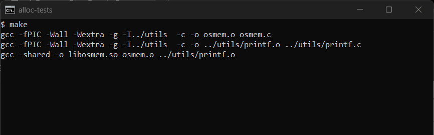
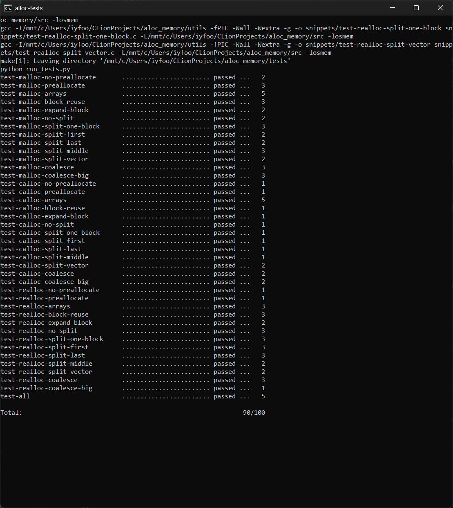

# Memory allocator

Реалізація `os_malloc`, `os_calloc`, `os_realloc` та `os_free` на основі `brk()` / `mmap()`
за завданням [memory-allocator](https://github.com/open-education-hub/operating-systems/tree/main/content/assignments/memory-allocator).

Код алокатора знаходиться в `src/osmem.c`.

При виконанні лабораторної роботи використовувалась модель Claude Opus 5.5 (Anthropic).

## Запуск

Потрібен Linux (або WSL) з `gcc`, `make`, `python3`, `ltrace` та `valgrind`:

```sh
sudo apt install build-essential python-is-python3 ltrace valgrind
```

Збірка бібліотеки:

```sh
cd src
make
```

Запуск усіх тестів:

```sh
cd tests
make check
```

Окремий тест:

```sh
cd tests
python run_tests.py -d test-all
```

## Результати




